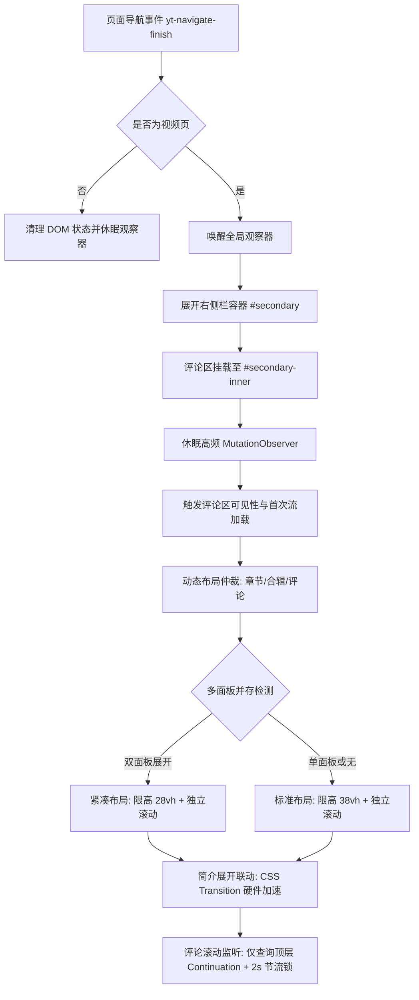

# YouTube Comments to Sidebar

适用于 Tampermonkey / Violentmonkey 的 YouTube 侧边栏评论区脚本。将视频下方评论区重排至右侧，兼容分集列表、分段章节、字幕转写与深浅双色主题。

---

## 功能特性

- **评论区侧置**：隐藏右侧推荐视频信息流，将完整原生评论区挂载至侧边栏，支持随视窗自适应高度与独立滚动。
- **分段与分集原生兼容**：
  - 展开分段章节（Chapters）或字幕转写（Transcript）时，以独立卡片形式吸顶内嵌，保留原版 Polymer 事件绑定与折叠交互。
  - 兼容合辑列表、剧集面板与播放列表（Playlists / Episodes），根据展开或折叠状态自适应调整容器高度。
- **多面板并存排版**：当播放列表与章节面板同时展开时，自动切换至紧凑模式（限制各面板最大高度为 28vh），确保评论区具备可用可视区域。
- **主题自适应**：解耦浅色与深色色彩变量，原生匹配 YouTube 浅色模式、深色模式与微光氛围模式（Cinematics）。
- **硬件加速动效**：视频简介（详情）展开与折叠时，侧边栏高度采用 CSS `cubic-bezier(0.2, 0.9, 0.3, 1)` 硬件加速过渡，避免逐帧布局重排。
- **滚动加载隔离与防抖**：将分页延续（Continuation）查询严格限制在主评论流作用域内，排除子楼层回复节点，并设置 2 秒状态节流锁，防止重复加载。
- **布局隔离与低能耗**：
  - 评论容器应用 `contain: layout style`，隔离内部 DOM 变化引起的页面全局重排（Reflow）。
  - 评论区挂载完成后休眠全局 DOM 观察器，路由切换时重新唤醒，降低待机资源消耗。
- **全屏模式守卫**：全屏播放时自动隐藏侧边栏，退出全屏后恢复显示。

---

## 运行流程

---

## 安装使用

### 前置要求
安装以下任意一款浏览器脚本管理器：
- Tampermonkey
- Violentmonkey
- Greasemonkey

### 安装方式
- 直接安装：[安装最新版本 (Raw)](https://raw.githubusercontent.com/tom613951/youtube-comments-sidebar/main/youtube-comments-to-side.user.js)
- 手动安装：复制 [youtube-comments-to-side.user.js](./youtube-comments-to-side.user.js) 源码至脚本管理器新建脚本中保存。

---

## 开源协议

本项目采用 [MIT License](LICENSE) 协议开源。
