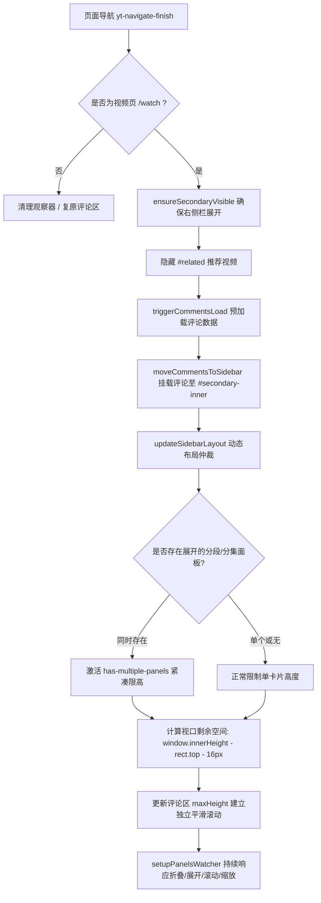

# YouTube 评论移至右侧 (YouTube Comments to Sidebar)

适用于 Tampermonkey / Violentmonkey / Greasemonkey 的现代化用户脚本。将 YouTube 视频下方的评论区重排至右侧推荐视频栏区域，实现一边观看视频一边浏览与互动评论。

深度重构升级至 **v3.0**，全面适配 YouTube 最新改版与网格布局，彻底解决分集区块（播放列表/剧集）、分段区块（章节/转写）与评论区的挤压与排版冲突。

---

## ✨ 核心特性

- **评论区右侧重排**：将视频下方的完整评论组件平滑移至右侧侧边栏，隐藏无关的推荐视频信息流。
- **全方位分段区块（Chapters）内嵌**：
  - 展开视频分段、章节列表或字幕转写文稿（Transcript）时，以独立卡片在右侧顶部优雅内嵌展示。
  - 保留 YouTube 原生 `#panels` 架构与 Polymer 事件绑定，拒绝粗暴挪动 DOM 导致的事件脱钩与循环抖动。
  - 面板内容区域独立平滑滚动，标题栏吸顶，支持一键随时折叠与关闭。
- **全格式分集区块（Playlist / Episodes）适配**：
  - 完美兼容视频合辑、播放列表、播客合辑、课程分集与剧集面板（TV Shows / Episodes）。
  - 原生支持播放列表的折叠状态（`collapsed`），收起时仅占一行标题栏，展开时自适应限制高度并独立滚动。
  - 彻底修复旧版未经验证即隐藏播放列表导致的“分集面板意外消失”问题。
- **智能多面板共存与防冲突机制**：
  - **分段 + 分集 + 评论 三者共存**：当用户同时展开章节与播放列表时，自动触发紧凑排版模式（`has-multiple-panels`），每个面板合理压缩限高，为下方的评论区保留充足的可视空间。
  - **视口自适应动态定高**：实时监测评论区顶部相对视口的距离（`rect.top`），动态计算并限制 `max-height`，确保无论页面滚动到何种位置，评论区底部始终精准贴合视口底端（预留 16px 呼吸间距），杜绝滚动条失效或内容被屏幕截断。
- **评论平滑加载与无限滚动**：
  - 优先调用 YouTube 底层 `onVisible()` 与 `triggerInitialContinuations()` 语义加载接口，移除导致屏幕跳跃的旧版滚屏拉取。
  - 监听右侧评论区内部滚动触底事件，无缝触发下一页评论数据懒加载。
- **最新版布局与主题兼容**：
  - 双重兼容经典 `ytd-watch-flexy` 与新一代 `ytd-watch-grid` 容器。
  - 自动屏蔽 YouTube 实验性的简易侧边评论，防止双份评论区冲突。
  - 修复影院模式（Theater Mode）下遮挡视频画面的问题，保持原生侧边排列。
  - 采用 YouTube 语义化 CSS Token（`var(--yt-spec-...)`），完美融入浅色、深色主题及氛围光模式（Cinematics）。
- **SPA 单页导航全生命周期同步**：精准响应 `yt-navigate-finish` 与路由跳转，切换非视频页时干净重置状态并复原组件。

---

## 📦 安装使用

### 前置要求

在浏览器中安装以下任意一款用户脚本管理器：
- [Tampermonkey](https://www.tampermonkey.net/)（推荐）
- [Violentmonkey](https://violentmonkey.github.io/)
- [Greasemonkey](https://www.greasespot.net/)

### 安装方法

1. 打开 [youtube-comments-to-side.user.js](./youtube-comments-to-side.user.js)。
2. 点击右上角的 **Raw** 按钮触发脚本管理器安装提示。
3. 确认并点击 **安装**。
4. 打开任意 YouTube 视频页面即可生效。

---

## 🏗️ 架构与实现原理

---

## 📄 开源协议

本项目采用 [MIT](LICENSE) 协议开源。
