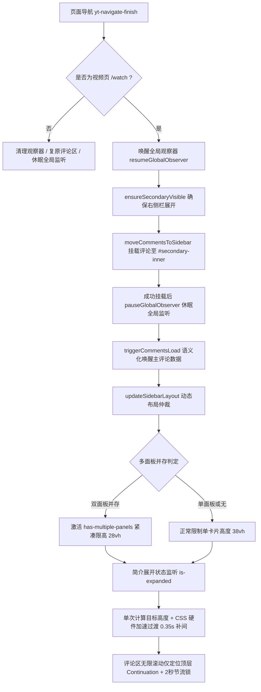

# YouTube 评论移至右侧 (YouTube Comments to Sidebar)

适用于 Tampermonkey / Violentmonkey / Greasemonkey 的现代化用户脚本。将 YouTube 视频下方的评论区重排至右侧推荐视频栏区域，实现一边观看视频一边浏览与互动评论。

深度重构升级至 **v3.4**，全面适配 YouTube 最新改版与网格布局，彻底解决分集区块（播放列表/剧集）、分段区块（章节/转写）与评论区的挤压与排版冲突，引入硬件加速动效消除简介展开卡顿，增加回复作用域隔离与节流锁，并加入 MutationObserver 空闲休眠与 CSS 布局隔离（Containment），实现极致的健壮性与近乎 0% 的待机 CPU 消耗。

---

## ✨ 核心特性

- **评论区右侧重排**：将视频下方的完整评论组件平滑移至右侧侧边栏，隐藏无关的推荐视频信息流。
- **浅色 / 深色主题原生融入**：
  - 精确分离明暗色彩变量体系，彻底解决浅色主题下侧边栏卡片头部出现的“黑块”问题。
  - 完美适配 YouTube 浅色模式、深色模式与微光氛围模式（Cinematics）。
- **全方位分段区块（Chapters）内嵌**：
  - 展开视频分段、章节列表或字幕转写文稿（Transcript）时，以独立卡片在右侧顶部优雅内嵌展示。
  - 保留 YouTube 原生 `#panels` 架构与 Polymer 事件绑定，拒绝粗暴挪动 DOM 导致的事件脱钩与循环抖动。
  - 面板内容区域独立平滑滚动，标题栏吸顶，支持一键随时折叠与关闭。
- **全格式分集区块（Playlist / Episodes）适配**：
  - 完美兼容视频合辑、播放列表、播客合辑、课程分集与剧集面板（TV Shows / Episodes）。
  - 原生支持播放列表的折叠状态（`collapsed`），收起时仅占一行标题栏，展开时自适应限制高度并独立滚动。
- **智能多面板共存与防冲突机制**：
  - **分段 + 分集 + 评论 三者共存**：当用户同时展开章节与播放列表时，自动触发紧凑排版模式（`has-multiple-panels`），每个面板合理压缩限高，为下方的评论区保留充足的可视空间。
- **硬件加速丝滑拉长动效**：
  - 展开/折叠视频详情（简介）时，侧边栏高度平滑延伸对齐，采用 CSS `cubic-bezier(0.2, 0.9, 0.3, 1)` 硬件加速过渡；
  - 废弃引起 Layout Thrashing（布局抖动）的每帧 `ResizeObserver` 轮询计算，改为按状态触发单次高度分配，实现真正的 60/120fps 满帧平滑拉长。
- **Continuation 作用域隔离与防重复机制**：
  - 严格限制懒加载触发范围：仅查询顶层主评论流末尾的 Continuation，**绝对排除**任何位于 `ytd-comment-replies-renderer` 或子楼层内部的回复 Continuation。
  - 增加 2 秒全局节流锁与状态标志，彻底解决滚屏时误触子回复无限复制重复刷屏的严重 bug。
- **极致效能：CSS 布局隔离与观察器休眠（v3.4 升级）**：
  - **CSS Containment**：对移位后的评论区注入 `contain: layout style;`，评论区内部成百上千节点的滚动/回复/点赞更新完全在内部闭环，不再向外波及整个 YouTube 页面的 Reflow 计算；
  - **Observer 智能休眠**：在评论区成功移位后，主动暂停（`disconnect`）全局高频 DOM 监听器，待机状态 CPU 占用近乎 0%，仅在路由切换时精准唤醒。
- **全屏与各模式防御**：
  - 原生全屏模式（Fullscreen）自动彻底隐藏侧边栏，杜绝画面溢出遮挡；
  - 影院模式（Theater Mode）保持下方原生侧边布局，拒绝覆盖主画面。
  - 双重兼容经典 `ytd-watch-flexy` 与新一代 `ytd-watch-grid` 容器。

---

## 📦 安装使用

### 前置要求

在浏览器中安装以下任意一款用户脚本管理器：
- [Tampermonkey](https://www.tampermonkey.net/)（推荐）
- [Violentmonkey](https://violentmonkey.github.io/)
- [Greasemonkey](https://www.greasespot.net/)

### 安装方法

1. 打开 [youtube-comments-to-side.user.js](./youtube-comments-to-side.user.js)。
2. 点击右上角的 **Raw** 按钮触发脚本管理器安装提示。
3. 确认并点击 **安装**。
4. 打开任意 YouTube 视频页面即可生效。

---

## 🏗️ 架构与实现原理

---

## 📄 开源协议

本项目采用 [MIT](LICENSE) 协议开源。
