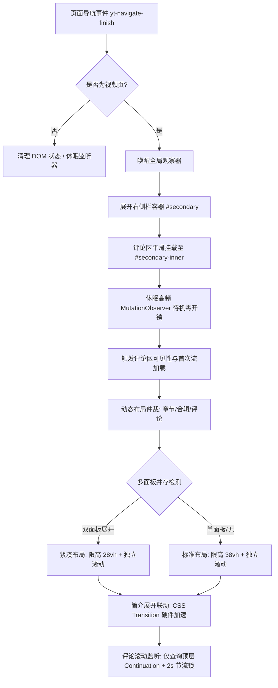

# YouTube 评论移至右侧 (YouTube Comments to Sidebar)

现代化 YouTube 侧边栏评论区用户脚本。将视频底部评论区重排至右侧推荐栏，实现边看视频边浏览与互动；原生兼容分集列表、章节分段、字幕转写与双色主题。

---

## ⚡ 核心能力与关键修复

| 维度 | 原生痛点 / 旧版缺陷 | v3.4 解决方案 |
| :--- | :--- | :--- |
| **侧边多面板冲突** | 打开播放列表或章节时互相遮挡或挤压评论区 | 原生内嵌卡片化，动态仲裁双面板并存模式（`has-multiple-panels`） |
| **主题色彩融合** | 浅色主题卡片头部出现异常黑块 | 彻底解耦明暗主题变量，精确匹配 YouTube 原生基底色与边框色 |
| **简介展开动效** | 展开视频详情时侧边栏跟随拉长卡顿掉帧 | 废弃逐帧布局轮询，采用 GPU 硬件加速过渡与单次状态高度对齐 |
| **无限滚动加载** | 滚动评论时误触发子楼层回复无限复制刷屏 | 严格隔离 Continuation 作用域至顶层主评论流，附加 2s 状态节流锁 |
| **运行时能耗** | 全局高频 DOM 监听消耗 CPU | 挂载后 MutationObserver 自动休眠；注入 CSS Containment 隔离重排 |

---

## 🚀 快速安装

### 前置要求
安装任意主流浏览器脚本管理器：
- [Tampermonkey](https://www.tampermonkey.net/)（推荐）
- [Violentmonkey](https://violentmonkey.github.io/)
- [Greasemonkey](https://www.greasespot.net/)

### 一键安装
👉 **[点击直接安装脚本 (Raw)](https://raw.githubusercontent.com/tom613951/youtube-comments-sidebar/main/youtube-comments-to-side.user.js)**

*或在本地将 [youtube-comments-to-side.user.js](./youtube-comments-to-side.user.js) 源码导入至脚本管理器。*

---

## 🛠️ 架构与生命周期状态机

---

## 📋 功能清单

- **评论侧置**：隐藏右侧推荐视频信息流，评论区自适应填满侧边栏。
- **章节与转写（Chapters & Transcript）**：保持 `#panels` 原生 Polymer 绑定，独立卡片吸顶，一键折叠。
- **播放列表与剧集（Playlists & Episodes）**：原生支持播放列表展开/收起态自适应高度计算。
- **全屏防御（Fullscreen Guard）**：全屏模式自动彻底隐藏侧边栏，退出后即刻恢复。
- **深浅主题自适应**：深色、浅色及微光模式（Cinematics）像素级融合。
- **零冗余开销**：利用 `contain: layout style;` 阻止重排扩散，闲置阶段观察器完全挂起。

---

## 📄 开源协议

本项目采用 [MIT License](LICENSE) 协议开源。
